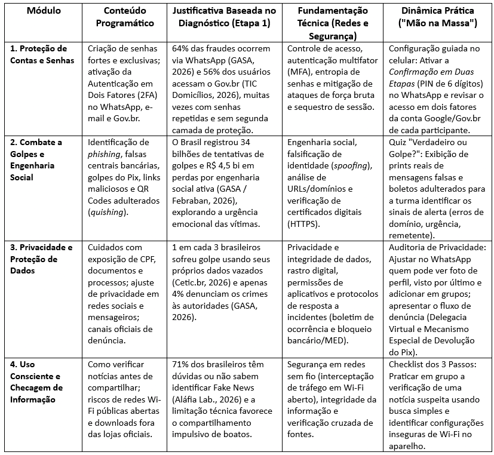

# Meu Kit de IA

Desafio de Projeto da [DIO](https://dio.me): monte o seu kit de IA para o dia a dia e delegue uma tarefa real, com você no comando.

O kit foi criado pelo Expert Bruno Lima com os prompts, templates, checklists e skills usados nas Aulas. Ele não é uma apostila: abra a pasta que resolve o seu problema, copie o modelo, adapte e use.

**Copie → adapte → teste → confira → melhore**

## Como Fazer o Desafio

Você não precisa instalar nada nem saber programar. Tudo acontece no navegador.

1. Clique em **Use this template**, depois em **Create a new repository**. Dê um nome simples, como `meu-kit-de-ia`, deixe **Public** e confirme.
2. Siga os passos abaixo com uma tarefa real da sua semana.
3. Preencha a seção [Minha Entrega](#minha-entrega) da sua cópia e entregue o link dela na DIO.

## Os Passos

1. **Escolha uma tarefa real.** Comece pelo trabalho que se repete na sua semana, como preparar uma reunião ou montar um relatório, e não pela ferramenta.
2. **Pegue um modelo.** Abra a pasta do kit que combina com a sua tarefa. Cada modelo tem um botão de copiar no canto.
3. **Adapte.** Troque o que está entre colchetes pelo seu contexto, objetivo, dados, limites e formato.
4. **Teste.** A primeira resposta é um ponto de partida. Ajuste até funcionar para a sua realidade.
5. **Delegue.** Com o [template de delegação](02-templates/03-delegacao.md), entregue a tarefa à IA. Peça o plano antes de ela começar, acompanhe e valide o resultado.
6. **Confira.** Provável não é o mesmo que verdadeiro. Revise com o [Pare, Confira, Use](03-checklists/01-pare-confira-use.md) antes de usar.

## O Que Tem no Kit

| Pasta | Para que serve |
|---|---|
| [01-prompts](01-prompts) | Pedidos prontos para adaptar: escrita, comunicação, pesquisa, comparação e preparação de reuniões |
| [02-templates](02-templates) | Estruturas para preencher: bom pedido, pesquisa e decisão, e delegação |
| [03-checklists](03-checklists) | Revisão de respostas, de textos e de tarefas delegadas |
| [04-skills](04-skills) | Como criar uma skill, e a Skill Preparador de Reuniões usada nas Aulas |
| [05-delegacao-e-automacao](05-delegacao-e-automacao) | Gatilhos de automação, supervisão e checkpoints |

## Os Frameworks das Aulas

- **Bom pedido:** contexto + instrução + objetivo + formato. Quanto menos a IA precisa adivinhar, melhor você consegue avaliar a resposta.
- **Pesquisa e decisão:** pergunta → pesquisa → critérios → comparação → você. Peça fontes quando precisar de informação externa. A decisão final é sua.
- **Segurança:** pare → confira → use. Valide fatos, números, datas, fontes e contexto.
- **Atalhos reutilizáveis:** criar → testar → ajustar → salvar. Separe as instruções fixas das informações que mudam a cada uso.
- **Delegação:** objetivo + contexto + recursos + limites + sucesso. Autonomia funciona melhor quando o resultado esperado está claro.
- **Supervisão:** definir → delegar → acompanhar → validar. Em tarefas maiores, confira o plano, acompanhe os checkpoints e valide o resultado.

> A IA pode ajudar você a escrever, pesquisar, organizar e executar. A responsabilidade pelo resultado continua sendo sua.

---

## Minha Entrega

Na sua cópia, abra este README, clique no lápis (**Edit this file**) e role até aqui. Troque cada frase em itálico pelo que você fez e cole o texto dentro dos blocos já prontos. Para pôr um print, é só colar a imagem com Ctrl+V. No fim, clique em **Commit changes**.

Nada de e-mail, nome de cliente, dado da empresa, senha ou informação pessoal nos textos e nos prints.

### Minha Tarefa Real

Escolhi estruturar o planejamento completo e o material educativo de uma **atividade de extensão universitária sobre Inclusão Digital e Segurança na Internet para a Comunidade**. A tarefa envolveu levantar dados atualizados sobre golpes digitais e exclusão tecnológica, diagnosticar as principais vulnerabilidades da população, estruturar a matriz de ação e criar o roteiro de uma apresentação de 11 slides para gravação em vídeo. Vale muito a pena automatizar esse fluxo porque transformar pesquisas extensas em materiais didáticos claros e organizados é uma demanda recorrente nos meus estudos e projetos.

### Meus Atalhos

Adaptei dois modelos da pasta `01-prompts` (`03-pesquisar-um-assunto.md` e `02-adaptar-comunicacao.md`):
- No **primeiro atalho** (pesquisa e diagnóstico), mantive fixas a estrutura da tabela (categorias, dificuldades, evidências, exemplos e nível de risco) e a regra de separar fatos comprovados de interpretações, mudando apenas o tema e o período das fontes.
- No **segundo atalho** (roteiro didático), deixei fixas as regras de acessibilidade visual, limite de texto por slide, obrigatoriedade de dinâmica prática ("mão na massa") e slide final de referências, alterando apenas o diagnóstico base, o público-alvo e a quantidade de slides.

```text
Atue como um designer instrucional especialista em educação comunitária e inclusão.
Com base no diagnóstico abaixo, crie o roteiro completo de uma apresentação de [NÚMERO] slides no PowerPoint para o público: [DESCREVER PÚBLICO-ALVO].

Diagnóstico base:
[COLAR A TABELA OU RESUMO DO DIAGNÓSTICO]

Para cada slide, entregue:
- Título claro e direto
- Texto na tela (máximo de 3 a 4 tópicos curtos, linguagem simples, sem jargões técnicos)
- Sugestão visual (ícones, gráficos ou exemplos práticos)
- Fala do apresentador (roteiro natural para guiar a explicação)

Regras obrigatórias:
- Inclua pelo menos 1 slide de dinâmica prática ("mão na massa").
- Inclua 1 slide final com as fontes consultadas e links úteis.
```


### Minha Delegação

```text
OBJETIVO
Gerar a matriz de planejamento (Etapa 2) e o roteiro de 11 slides para PowerPoint (Etapa 3) de uma oficina comunitária sobre "Inclusão Digital e Segurança na Internet".

CONTEXTO
Já realizei o levantamento inicial (Etapa 1) com dados atualizados de 2025 e 2026 (GASA, Cetic.br, Febraban e Aláfia Lab) mostrando que os principais problemas da comunidade são golpes via WhatsApp, vazamento de CPF e baixa adoção de verificação em duas etapas. A oficina será gravada em vídeo (10 a 15 minutos) para acesso assíncrono.

RECURSOS
Tabela de diagnóstico da Etapa 1 com fontes, estatísticas e exemplos práticos já validados.

LIMITES
Não inventar estatísticas ou fontes novas; usar apenas os dados validados na Etapa 1. Não publicar nem enviar nada externamente — eu revisarei o texto final, montarei os slides no PowerPoint e gravarei o vídeo.

SUCESSO
Conteúdo entregue em linguagem simples e acessível para adultos e idosos, com passo a passo prático para ativar segurança no celular e um slide final com referências verificáveis.

Antes de começar, mostre como pretende realizar essa tarefa.
```

### O Plano da IA

Seguindo o fluxo de supervisão (Objetivo → plano → execução → resultado), exigi o plano antes da redação final. A IA estruturou a matriz de conteúdos dividindo a oficina em 4 módulos lógicos (Proteção de Contas e Senhas, Combate a Golpes, Privacidade de Dados e Checagem de Informação) e propôs uma sequência de 10 slides. No checkpoint de aprovação, eu ajustei o plano solicitando a inclusão de um 11º slide dedicado exclusivamente às referências e links das pesquisas, além de adaptar a dinâmica para o formato de vídeo gravado (com pausas orientadas para o espectador configurar o próprio celular).



### O Resultado

A IA entregou o roteiro detalhado dos 11 slides com textos curtos, sugestões visuais, falas prontas para a gravação e a lista de fontes formatada. Antes de montar a apresentação no PowerPoint, eu conferi o resultado aplicando os checklists 01-pare-confira-use.md e 02-revisar-texto-da-ia.md:

- Validei todos os percentuais e valores financeiros (como os dados da GASA, Cetic.br, Febraban e Aláfia Lab) diretamente nas fontes originais para garantir que não havia números inventados;

- Separei o que era fato estatístico do que era sugestão didática da IA (como o quiz "Verdadeiro ou Golpe?");

- Testei os links das referências e adaptei o tom da linguagem para o público da minha comunidade antes de gravar a apresentação.

<details>
<summary><strong>Clique aqui para expandir o roteiro completo dos 11 slides (Conferido e Ajustado)</strong></summary>

<br>

#### Orientações Visuais Rápidas (Para o Design no PowerPoint)
- **Fonte e Tamanho:** Use fontes limpas (*Segoe UI*, *Arial* ou *Calibri*) com tamanho mínimo de **24 pt** no corpo do texto (para facilitar a leitura de idosos e pessoas com dificuldade visual).
- **Paleta de Cores:** Fundo claro (branco ou cinza bem suave) com títulos em **azul-marinho** (transmite confiança) e destaques de alerta em **vermelho ou laranja** (para sinais de golpe) e **verde** (para boas práticas).
- **Regra de Ouro:** Evite blocos longos de texto. Use ícones, setas e imagens reais de exemplos (prints simulados).

---

#### Roteiro Slide a Slide — Apresentação PowerPoint

**Slide 1: Capa**
- **Título:** Escudo Digital na Comunidade
- **Subtítulo:** Como usar a internet com segurança, proteger seus dados e evitar golpes no dia a dia
- **Rodapé:** Atividade de Extensão Universitária | Curso: [Nome do Curso] | Estudante: [Seu Nome]
- **Sugestão Visual:** Ícone grande de um cadeado ou escudo digital ao lado de um smartphone.

**Slide 2: Por que estamos aqui hoje? (O Cenário Atual)**
- **Título:** A internet faz parte da nossa rotina — mas exige cuidado
- **Texto na Tela (Tópicos curtos):**
  - Hoje resolvemos tudo pelo celular: banco, Pix, WhatsApp e Gov.br.
  - No Brasil, acontecem **34 bilhões de tentativas de golpes** por ano *(GASA, 2026)*.
  - A maioria dos golpes **não invade o celular** — eles tentam enganar quem está usando.
- **Fala do Apresentador:** *"Pessoal, hoje a internet facilita muito a nossa vida, mas os golpistas também estão lá. A boa notícia é que, com alguns ajustes simples no celular, a gente consegue barrar quase todos esses problemas."*

**Slide 3: Onde os golpes mais acontecem?**
- **Título:** Fique de olho nos canais mais visados
- **Texto na Tela (Destaque visual com ícones):**
  - **64% dos golpes** chegam pelo **WhatsApp** *(GASA, 2026)*.
  - **1 em cada 3 pessoas** já recebeu golpe usando seus próprios dados (como CPF ou endereço) *(Cetic.br, 2026)*.
  - **Regra nº 1:** Se a mensagem dá **pressa**, **medo** ou **vantagem fácil**, desconfie!
- **Sugestão Visual:** Gráfico simples de barras ou ícones grandes do WhatsApp, telefone e mensagem SMS com um sinal de alerta.

**Slide 4: Os 4 Golpes Mais Comuns (E Como Não Cair)**
- **Título:** Conheça as armadilhas do dia a dia
- **Texto na Tela (Dividido em 4 quadrantes):**
  1. **Falso Parente no WhatsApp:** Foto igual, número novo pedindo Pix urgente. → *Ligue para o número antigo antes!*
  2. **Falsa Central do Banco:** Ligação dizendo que "clonaram seu cartão". → *Desligue e ligue você mesmo para o número atrás do cartão.*
  3. **Link Falso (Gov.br / Promoções):** Mensagens prometendo dinheiro esquecido ou prêmio. → *Nunca clique em links recebidos por SMS ou grupos.*
  4. **Boleto / QR Code Adulterado:** Conferir sempre o nome de quem vai receber antes de confirmar o Pix.

**Slide 5: Dinâmica Rápida — Verdadeiro ou Golpe?**
- **Título:** Vamos testar nosso olhar! Isso é seguro ou é cilada?
- **Texto na Tela (Exibir 2 prints lado a lado):**
  - *Exemplo A (Golpe):* Mensagem no WhatsApp com erro de português, link estranho (`www.gov-resgate-agora.xyz`) e frase: *"Último dia para sacar seu benefício!"*.
  - *Exemplo B (Seguro):* Acesso direto pelo aplicativo oficial do banco ou site terminando em `.gov.br`.
- **Fala do Apresentador:** *"Olhem para a tela: o que entrega que a primeira mensagem é falsa? O endereço do site estranho e a pressa para você clicar sem pensar."*

**Slide 6: Blindagem nº 1 — Senhas Fortes**
- **Título:** A chave da sua casa digital: como criar boas senhas
- **Texto na Tela:**
  - **Não use:** Data de nascimento, `123456`, placa de carro ou nome de parentes.
  - **Não repita:** A senha do banco não pode ser a mesma do Facebook ou e-mail.
  - **Dica prática (Frase-Senha):** Misture uma frase fácil com números e símbolos. Ex.: `CafeComLeite@2026`
  - Anote suas senhas em um **caderno guardado em casa**, nunca no bloco de notas do celular.

**Slide 7: Blindagem nº 2 — Confirmação em Duas Etapas (2FA)**
- **Título:** A tranca extra do seu WhatsApp
- **Texto na Tela (Passo a passo visual):**
  - Mesmo que alguém descubra seu código SMS, não entra sem o seu PIN.
  - **Como ativar agora no WhatsApp:**
    1. Abra o **WhatsApp** e toque nos **3 pontinhos** (ou *Configurações*).
    2. Vá em **Conta** → **Confirmação em duas etapas**.
    3. Toque em **Ativar** e crie uma senha de **6 números** que você não esqueça.
- **Fala do Apresentador:** *"Vamos pegar o celular agora e fazer esse passo juntos? Quem precisar de ajuda, levanta a mão que eu vou até vocês."*

**Slide 8: Privacidade e Proteção dos Seus Dados**
- **Título:** Quem pode ver suas informações na internet?
- **Texto na Tela:**
  - **No WhatsApp (Configurações → Privacidade):**
    - *Foto do perfil:* Deixe visível apenas para **"Meus contatos"** (evita que golpistas copiem sua foto).
    - *Grupos:* Mude para **"Meus contatos"** (impede que adicionem você em grupos desconhecidos).
  - **Na rua / Wi-Fi público:** Evite acessar aplicativo de banco usando Wi-Fi aberto de praças, rodoviárias ou shoppings.

**Slide 9: Notícia Verdadeira ou Fake News?**
- **Título:** Antes de encaminhar, faça o teste dos 3 passos
- **Texto na Tela:**
  - **71% dos brasileiros** têm dificuldade para saber se uma notícia é verdadeira *(Aláfia Lab, 2026)*.
  - **Checklist antes de compartilhar:**
    1. **Quem escreveu?** Tem nome de jornal conhecido ou é só um texto solto com "Repasse"?
    2. **Tem data?** Muitas notícias antigas voltam como se fossem de hoje.
    3. **Pesquise no Google:** Digite o título da notícia; se for verdade, estará nos grandes portais.

**Slide 10: Caiu em um golpe? O que fazer na hora!**
- **Título:** Passo a passo de emergência (Não tenha vergonha de agir!)
- **Texto na Tela:**
  - Apenas **4% das vítimas** denunciam *(GASA, 2026)* — mas agir rápido ajuda a bloquear os golpistas!
  - **1º Passo:** Ligue imediatamente para o seu **banco** e peça o bloqueio da conta e o **MED (Mecanismo Especial de Devolução do Pix)**.
  - **2º Passo:** Avise seus familiares e amigos (caso tenham clonado seu WhatsApp).
  - **3º Passo:** Registre um **Boletim de Ocorrência** (pode ser feito pela internet na Delegacia Virtual do seu estado).
- **Encerramento:** *"Obrigado pela participação! Segurança digital se constrói com informação compartilhada."*

**Slide 11: Referências e Fontes Consultadas (Adicionado na Revisão)**
- **Título:** De onde vêm esses dados? (Fontes e Pesquisas)
- **Texto na Tela:**
  - **Aliança Global Anti-Golpes (GASA) / CNN Brasil (2026):** *O Estado dos Golpes no Brasil 2026* — `https://www.cnnbrasil.com.br/economia/macroeconomia/`
  - **Cetic.br / NIC.br (2025–2026):** *TIC Domicílios e Levantamento sobre Uso Indevido de Dados* — `https://cetic.br/pt/pesquisas/domicilios/`
  - **Febraban (2026):** *Relatórios de Prevenção a Fraudes e Segurança Cibernética* — `https://portal.febraban.org.br/`
  - **Aláfia Lab / G1 & Revista Veja (2026):** *Pesquisas sobre Desinformação e Checagem de Fatos* — `https://g1.globo.com/fato-ou-fake/`
  - **CERT.br / NIC.br:** *Cartilha de Segurança para Internet* — `https://cartilha.cert.br/`

</details>

### Como Foi para Você

Aplicar o método de delegação com checkpoints mudou completamente a forma como uso a IA no dia a dia. Em vez de pedir tudo de uma vez e gastar tempo corrigindo textos genéricos ou dados sem fonte, passei a atuar como supervisor do processo: primeiro valido os fatos, depois aprovo a estrutura do plano e só então gero o material final. Como próximo passo de evolução, pretendo transformar esse fluxo completo em uma Skill reutilizável (seguindo o guia da pasta 04-skills) e automatizar a tabulação das respostas de formulários comunitários por gatilho de evento (05-delegacao-e-automacao).